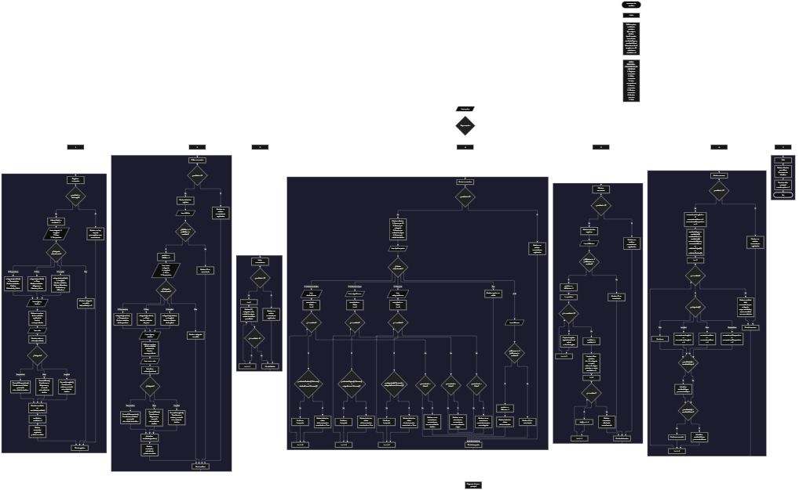

Este proyecto, llamado <b>conversor de medidas</b>, fue desarrollado en <b>visual basic .net</b> como un ejercicio práctico para fortalecer la lógica de programación mediante la creación de un sistema de conversión de unidades desde la consola. El programa cuenta con un menú principal de siete opciones que permite <b>registrar, editar, eliminar, buscar, listar y consultar resúmenes</b> de las conversiones realizadas. Cada conversión almacena información como la categoría, el valor original, las unidades de origen y destino y el resultado obtenido, utilizando arreglos con una capacidad máxima de <b>10 conversiones durante la ejecución</b>. El sistema trabaja con tres categorías principales: <b>longitud, peso y temperatura</b>, e incorpora funciones independientes para obtener las unidades seleccionadas y realizar los cálculos correspondientes. Durante su desarrollo se aplicaron conceptos fundamentales de programación, como variables, arreglos, estructuras condicionales, ciclos repetitivos, estructuras de selección, funciones y operaciones matemáticas. Este proyecto permite poner en práctica los conocimientos adquiridos en Visual Basic .NET y sirve como base para desarrollar aplicaciones de conversión y procesamiento de datos más avanzadas.

<h2 align="center">⚙️ Funcionamiento del menú principal</h2>

### ➕ Registrar conversión

La opción <b>1) registrar conversión</b> permite almacenar una nueva conversión de medidas. Antes de realizar el registro, el sistema comprueba que la cantidad de conversiones almacenadas sea menor que la capacidad de los arreglos, utilizando la condición <b>cantidad &gt;= ids.Length</b>. Si existe espacio disponible, asigna un identificador mediante <b>ids(cantidad) = cantidad + 1</b> y solicita seleccionar una de las tres categorías disponibles: <b>longitud, peso o temperatura</b>. Dependiendo de la categoría seleccionada, muestra las unidades correspondientes y solicita la unidad de origen, la unidad de destino y el valor que se desea convertir. Para obtener los nombres de las unidades utiliza las funciones <b>ObtenerUnidadLongitud(), ObtenerUnidadPeso() y ObtenerUnidadTemperatura()</b>. Posteriormente, ejecuta la función de conversión correspondiente para calcular el resultado y almacenar la información en los arreglos. Finalmente, aumenta la variable <b>cantidad</b> en uno y muestra los datos de la conversión registrada. Si se alcanza la capacidad máxima, presenta el mensaje <b>"No hay espacio para registrar mas conversiones."</b>. Si se introduce una categoría incorrecta, muestra <b>"Categoria no valida."</b>, limpia el identificador asignado y regresa al menú principal.

### ✏️ Editar conversión

La opción <b>2) editar conversión</b> permite modificar los datos de una conversión registrada. Primero, el programa comprueba si existen conversiones almacenadas mediante la variable <b>cantidad</b>. Si no hay registros, muestra el mensaje <b>"No existen conversiones registradas."</b>. En caso contrario, presenta una lista con el ID, la categoría, el valor original, las unidades de origen y destino y el resultado de cada conversión. Después, solicita el ID de la conversión que se desea editar y comprueba que se encuentre dentro del rango permitido mediante la condición <b>idEditar &gt;= 1 And idEditar &lt;= cantidad</b>. Si la selección es válida, obtiene la posición correspondiente restando uno al identificador mediante <b>posicion = idEditar - 1</b>. A continuación, solicita seleccionar una nueva categoría, elegir las unidades de origen y destino e introducir el nuevo valor. Según la categoría seleccionada, utiliza las funciones correspondientes para obtener las unidades y calcular nuevamente el resultado, actualizando directamente los arreglos. Finalmente, muestra el mensaje <b>"Conversion actualizada correctamente."</b> junto con los datos modificados. Si el ID no corresponde a una conversión registrada, presenta el mensaje <b>"ID no encontrada."</b>. Si se selecciona una categoría incorrecta, muestra <b>"Categoria no valida."</b> y regresa al menú sin completar la actualización.

### 📋 Listar conversiones

La opción <b>3) listar conversiones</b> permite visualizar todas las conversiones registradas actualmente. Antes de mostrar la información, el programa comprueba si la variable <b>cantidad</b> es igual a cero. Si no existen registros, presenta el mensaje <b>"No existen conversiones registradas."</b>. Si hay conversiones disponibles, utiliza un ciclo <b>For</b> para recorrer los arreglos desde la primera posición hasta la cantidad actual de registros. Durante el recorrido, muestra el ID, la categoría, el valor original, la unidad de origen, la unidad de destino y el resultado obtenido de cada conversión. Esta función facilita consultar todas las conversiones almacenadas sin necesidad de buscarlas individualmente.

### 🔎 Buscar conversión

La opción <b>4) buscar conversión</b> permite localizar registros mediante cuatro criterios diferentes: <b>ID, categoría, unidad de origen y unidad de destino</b>. Primero, el programa comprueba si existen conversiones registradas. Si no hay información almacenada, muestra el mensaje <b>"No existen conversiones registradas."</b>. En caso contrario, presenta un submenú con los cuatro criterios de búsqueda disponibles. Si se selecciona la búsqueda por <b>ID</b>, solicita el identificador y comprueba que esté dentro del rango de conversiones registradas. Si es válido, obtiene directamente la posición mediante <b>idBuscar - 1</b> y muestra toda la información correspondiente. Si se selecciona la búsqueda por <b>categoría</b>, solicita el nombre de la categoría y recorre el arreglo <b>categorias</b> para comparar los valores mediante <b>categorias(i).ToLower() = categoriaBuscar.ToLower()</b>. Si se busca por <b>unidad de origen</b> o <b>unidad de destino</b>, realiza un recorrido similar utilizando los arreglos <b>unidadesOrigen</b> y <b>unidadesDestino</b>, respectivamente. En las búsquedas por texto, utiliza la variable lógica <b>encontrado</b> para determinar si existen coincidencias y muestra todos los registros que cumplen el criterio. Las comparaciones no distinguen entre mayúsculas y minúsculas, pero requieren que el texto coincida exactamente. Si no se encuentra ningún registro, presenta el mensaje correspondiente a cada criterio. Cuando se selecciona una opción diferente de las cuatro disponibles, muestra <b>"Opcion no valida."</b>.

### 🗑️ Eliminar conversión

La opción <b>5) eliminar conversión</b> permite eliminar una conversión mediante su identificador. Primero, el programa comprueba si existen conversiones registradas. Si no hay registros, muestra el mensaje <b>"No existen conversiones registradas."</b>. En caso contrario, presenta una lista con la información de todas las conversiones y solicita el ID que se desea eliminar. Después, comprueba que el identificador se encuentre dentro del rango permitido mediante la condición <b>idEliminar &gt;= 1 And idEliminar &lt;= cantidad</b>. Si el ID es válido, obtiene la posición correspondiente restando uno al identificador. Para mantener los registros organizados, utiliza un ciclo <b>For</b> que desplaza una posición hacia atrás los datos posteriores en los seis arreglos: <b>ids, categorias, valores, unidadesOrigen, unidadesDestino y resultados</b>. Posteriormente, disminuye la variable <b>cantidad</b> en uno y limpia la última posición ocupada, asignando valores vacíos o cero según el tipo de dato. Finalmente, utiliza otro ciclo <b>For</b> para renumerar los identificadores desde uno hasta la cantidad actual de conversiones y muestra el mensaje <b>"Conversion eliminada correctamente."</b>. Si el ID seleccionado no corresponde a una conversión registrada, presenta el mensaje <b>"ID no encontrada."</b>.

### 📊 Mostrar resumen

La opción <b>6) mostrar resumen</b> permite consultar estadísticas generales de las conversiones registradas. Primero, el programa comprueba si existen registros almacenados. Si la cantidad es igual a cero, muestra el mensaje <b>"No existen conversiones registradas."</b>. Si existen conversiones, inicializa tres contadores para almacenar la cantidad de conversiones de <b>longitud, peso y temperatura</b>. También inicializa las variables <b>resultadoMayor</b> y <b>resultadoMenor</b> con el resultado de la primera conversión, además de guardar las unidades de origen y destino correspondientes. Después, utiliza un ciclo <b>For</b> para recorrer todos los registros. Durante el recorrido, incrementa el contador de la categoría correspondiente y compara los resultados para identificar el valor mayor y el menor, actualizando también las unidades asociadas a cada uno. Finalmente, muestra la cantidad total de conversiones, el número de conversiones por categoría, el mayor resultado y el menor resultado junto con sus respectivas unidades de origen y destino. Las comparaciones se realizan directamente sobre los valores numéricos almacenados, incluso cuando pertenecen a categorías o unidades diferentes.

### 🚪 Salir del menú principal

La opción <b>7) salir</b> permite finalizar la ejecución del programa y muestra el mensaje <b>"Gracias por utilizar Conversor de Medidas."</b>. El menú principal se encuentra dentro de una estructura repetitiva <b>Do ... Loop While</b>, que mantiene el programa en funcionamiento mientras la variable <b>opcion</b> sea diferente de siete. Cuando el usuario selecciona esta opción, se ejecuta el mensaje de despedida y la condición <b>opcion &lt;&gt; 7</b> deja de cumplirse, finalizando el ciclo y la ejecución del programa.

<h2 align="center">🧠 Temas aplicados en el proyecto</h2>

### 📦 Variables

En este proyecto se utilizan variables para controlar las opciones del menú, administrar la cantidad de conversiones registradas, seleccionar las categorías y unidades de medida, almacenar los valores originales y los resultados obtenidos, controlar las posiciones de los arreglos y determinar las coincidencias durante las búsquedas. También se utilizan variables auxiliares para calcular estadísticas y comparar los resultados de las conversiones. Cada variable cumple una función específica dentro de las operaciones del sistema.

🔢 **Opcion:** Almacena la opción seleccionada por el usuario en el menú principal.

📊 **Cantidad:** Controla el número actual de conversiones registradas.

🔄 **I:** Funciona como contador en los ciclos `For` y permite recorrer las posiciones de los arreglos.

🔎 **Tipo:** Almacena la categoría seleccionada durante el registro o la edición de una conversión.

🔍 **TipoBusqueda:** Almacena el criterio seleccionado en el submenú de búsqueda.

📌 **Origen y destino:** Almacenan las opciones numéricas seleccionadas para las unidades de origen y destino.

🆔 **IdEditar, idBuscar e idEliminar:** Almacenan los identificadores introducidos para editar, buscar o eliminar conversiones.

📍 **Posicion:** Determina la posición del arreglo correspondiente al ID seleccionado.

🔎 **CategoriaBuscar, origenBuscar y destinoBuscar:** Almacenan los textos introducidos por el usuario para realizar las búsquedas.

✅ **Encontrado:** Variable lógica que indica si se encontró una conversión que coincide con el criterio solicitado.

📈 **ConversionesLongitud, conversionesPeso y conversionesTemperatura:** Almacenan la cantidad de conversiones realizadas en cada categoría.

⬆️ **ResultadoMayor y conversionMayor:** Almacenan el mayor resultado encontrado y las unidades de origen y destino asociadas.

⬇️ **ResultadoMenor y conversionMenor:** Almacenan el menor resultado encontrado y las unidades de origen y destino asociadas.

### 🗃️ Arreglos

En este proyecto se utilizan seis arreglos paralelos para almacenar la información de las conversiones realizadas. Cada arreglo tiene una capacidad de <b>10 posiciones</b> y utiliza el mismo índice para representar los datos correspondientes a una misma conversión. Por ejemplo, la información de una conversión almacenada en la posición <b>0</b> se encuentra distribuida entre <b>ids(0), categorias(0), valores(0), unidadesOrigen(0), unidadesDestino(0) y resultados(0)</b>. Esta organización permite registrar, consultar, modificar, buscar, eliminar y organizar las conversiones mediante posiciones relacionadas.

🆔 **Ids(10):** Almacena los identificadores de las conversiones registradas.

📂 **Categorias(10):** Almacena la categoría correspondiente a cada conversión: longitud, peso o temperatura.

🔢 **Valores(10):** Almacena los valores originales introducidos por el usuario.

📥 **UnidadesOrigen(10):** Almacena las unidades de medida desde las cuales se realiza cada conversión.

📤 **UnidadesDestino(10):** Almacena las unidades de medida hacia las cuales se realiza cada conversión.

📊 **Resultados(10):** Almacena los resultados calculados mediante las funciones de conversión.

### 🔀 Estructuras condicionales

En este proyecto se utilizan las estructuras <b>If, ElseIf y Else</b> para controlar las operaciones del sistema y tomar decisiones según las opciones seleccionadas por el usuario. Estas condiciones permiten comprobar si existe espacio disponible antes de registrar una conversión, verificar si hay registros almacenados antes de realizar determinadas operaciones, identificar la categoría seleccionada, validar los identificadores utilizados para editar, buscar o eliminar conversiones y determinar si se encontraron coincidencias durante las búsquedas. También se utilizan para clasificar las conversiones por categoría y comparar los resultados con el propósito de identificar el mayor y el menor valor registrado.

### 🔄 Estructuras repetitivas

En este proyecto se utilizan los ciclos <b>Do ... Loop While</b> y <b>For</b>. El ciclo <b>Do ... Loop While</b> mantiene activo el menú principal y permite que el usuario realice diferentes operaciones hasta seleccionar la opción siete. Por otro lado, los ciclos <b>For</b> permiten recorrer los arreglos para mostrar las conversiones registradas, buscar coincidencias por categoría y unidades, presentar los registros antes de editarlos o eliminarlos y calcular las estadísticas del resumen. También se utilizan para desplazar los datos durante la eliminación de una conversión y renumerar los identificadores después de reorganizar los registros.

### 🎯 Estructura select case

En este proyecto se utiliza la estructura <b>Select Case</b> para seleccionar y ejecutar las operaciones correspondientes a las opciones del menú principal. Cada caso representa una funcionalidad específica: <b>registrar, editar, listar, buscar, eliminar, mostrar resumen y salir</b>. También se utiliza dentro de las funciones auxiliares para identificar las unidades seleccionadas y realizar las conversiones según las unidades de origen y destino. En el menú principal, el bloque <b>Case Else</b> permite mostrar el mensaje <b>"Opcion no valida."</b> cuando se introduce un número que no corresponde a ninguna de las opciones disponibles.

### 🔢 Dimensionamiento de arreglos

El programa utiliza la declaración de arreglos con el índice máximo <b>(9)</b> para establecer una capacidad de <b>10 posiciones</b> en cada uno de los seis arreglos. Esta capacidad permite administrar hasta diez conversiones durante la ejecución. La variable <b>cantidad</b> controla el número de registros ocupados y se utiliza para determinar las posiciones disponibles, recorrer los registros existentes y comprobar si se alcanzó la capacidad máxima. Además, la propiedad <b>ids.Length</b> permite consultar la longitud del arreglo de identificadores y utilizarla como referencia para controlar el límite de almacenamiento.

### 🔄 Reorganización de registros

Cuando se elimina una conversión, el programa utiliza un ciclo <b>For</b> que comienza en la posición correspondiente al identificador seleccionado y termina en <b>cantidad - 2</b>. En cada repetición, los datos de la posición siguiente se copian sobre la posición actual en los seis arreglos: <b>ids, categorias, valores, unidadesOrigen, unidadesDestino y resultados</b>. Después, la variable <b>cantidad</b> disminuye en uno y se limpian los datos de la última posición ocupada. Finalmente, otro ciclo <b>For</b> recorre los registros restantes y asigna nuevamente los identificadores mediante <b>ids(i) = i + 1</b>. De esta manera, las conversiones permanecen organizadas y los identificadores mantienen una secuencia consecutiva después de cada eliminación.

### 🧮 Funciones y parámetros

En este proyecto se utilizan seis funciones independientes para obtener los nombres de las unidades seleccionadas y realizar las conversiones correspondientes. Cada función recibe los datos necesarios mediante parámetros y devuelve un resultado utilizando la instrucción <b>Return</b>. Esta organización permite separar los cálculos matemáticos de las operaciones del menú principal, facilitando la comprensión, reutilización y mantenimiento del código.

📏 **ObtenerUnidadLongitud():** Recibe una opción numérica y devuelve el nombre de la unidad seleccionada entre metros, kilómetros, centímetros y milímetros.

⚖️ **ObtenerUnidadPeso():** Recibe una opción numérica y devuelve el nombre de la unidad seleccionada entre kilogramos, gramos y libras.

🌡️ **ObtenerUnidadTemperatura():** Recibe una opción numérica y devuelve el nombre de la unidad seleccionada entre Celsius, Fahrenheit y Kelvin.

📐 **ConvertirLongitud():** Recibe un valor y las unidades de origen y destino. Primero transforma el valor a metros y posteriormente calcula su equivalencia en la unidad de destino.

⚖️ **ConvertirPeso():** Recibe un valor y las unidades de origen y destino. Primero transforma el valor a kilogramos y después calcula su equivalencia en la unidad seleccionada.

🌡️ **ConvertirTemperatura():** Recibe un valor y las unidades de origen y destino. Primero transforma la temperatura a Celsius y después calcula su equivalencia en Fahrenheit, Kelvin o Celsius.

<h2 align="center">¿Cómo se implementaron las operaciones crud en el proyecto?</h2>

Las operaciones <b>crud</b> se implementaron mediante las opciones del menú principal, permitiendo administrar las conversiones registradas. La operación <b>crear</b> corresponde a <b>registrar conversión</b>, donde se selecciona una categoría, las unidades de medida y el valor que se desea convertir. La operación <b>leer</b> se realiza mediante las opciones <b>buscar conversión, listar conversiones y mostrar resumen</b>, que permiten consultar los registros y sus resultados. La operación <b>actualizar</b> corresponde a <b>editar conversión</b>, donde se modifican los datos de una conversión existente y se calcula nuevamente su resultado. Finalmente, la operación <b>eliminar</b> se realiza mediante la opción <b>eliminar conversión</b>, que elimina el registro seleccionado y reorganiza los arreglos para mantener la información ordenada. Estas operaciones utilizan variables, arreglos, estructuras condicionales, ciclos y funciones para administrar la información almacenada temporalmente durante la ejecución del programa.

<h2 align="center">Diagrama de flujo del proyecto</h2>

<h2 align="center">🛡️ Validaciones del programa</h2>

### 📭 No existen conversiones registradas

Esta validación se utiliza en las opciones de <b>editar, listar, buscar, eliminar y mostrar resumen</b>. El programa comprueba si la variable <b>cantidad</b> es igual a <b>0</b> y, si no existen conversiones almacenadas, muestra el mensaje <b>"No existen conversiones registradas."</b>. Esta comprobación evita continuar con operaciones que necesitan información almacenada cuando todavía no se ha registrado ninguna conversión.

### ⚠️ Capacidad máxima alcanzada

Esta validación se utiliza durante el registro de nuevas conversiones para controlar la capacidad máxima de los arreglos. El programa comprueba si <b>cantidad &gt;= ids.Length</b> antes de permitir un nuevo registro. Si existe espacio disponible, solicita la información de la conversión y aumenta el contador después de completar el proceso. En caso contrario, muestra el mensaje <b>"No hay espacio para registrar mas conversiones."</b>, impidiendo almacenar más de diez conversiones.

### ❌ ID no encontrado

Esta validación se utiliza durante las operaciones de edición, búsqueda por ID y eliminación. El programa comprueba que el identificador introducido sea mayor o igual a <b>1</b> y menor o igual a <b>cantidad</b>. Si el ID se encuentra dentro del rango permitido, obtiene la posición correspondiente mediante <b>id - 1</b> y realiza la operación solicitada. Si el identificador no corresponde a una conversión registrada, muestra el mensaje <b>"ID no encontrada."</b>.

### 🔎 Conversión no encontrada

Esta validación se utiliza durante las búsquedas por categoría, unidad de origen y unidad de destino. El programa inicializa la variable lógica <b>encontrado</b> con el valor <b>False</b> y recorre los arreglos correspondientes para comparar los datos almacenados con el texto introducido por el usuario. Cuando encuentra una coincidencia, cambia la variable a <b>True</b> y muestra la información de la conversión. Si termina el recorrido sin encontrar resultados, presenta el mensaje correspondiente: <b>"No se encontraron conversiones para esa categoria."</b>, <b>"No se encontraron conversiones con esa unidad de origen."</b> o <b>"No se encontraron conversiones con esa unidad de destino."</b>. Las comparaciones se realizan sin distinguir entre mayúsculas y minúsculas, pero requieren coincidencias exactas.

### ⚠️ Categoría no válida

Esta validación se utiliza al registrar o editar una conversión. El programa comprueba que la categoría seleccionada corresponda a una de las tres opciones disponibles: <b>1) longitud, 2) peso o 3) temperatura</b>. Si durante el registro se introduce otro valor, muestra el mensaje <b>"Categoria no valida."</b>, limpia el identificador asignado y regresa al menú principal mediante <b>Continue Do</b>. Durante la edición, si se introduce una categoría incorrecta, muestra el mismo mensaje y regresa al menú sin completar la actualización.

### ⚠️ Unidad no válida

Las funciones <b>ObtenerUnidadLongitud(), ObtenerUnidadPeso() y ObtenerUnidadTemperatura()</b> utilizan estructuras <b>Select Case</b> para devolver el nombre de la unidad seleccionada. Si se introduce una opción que no corresponde a las unidades disponibles, devuelven el texto <b>"No valida"</b>. Sin embargo, el programa no comprueba posteriormente si las unidades de origen y destino son válidas antes de realizar los cálculos. Por este motivo, una selección incorrecta puede producir un resultado de <b>0</b> y quedar almacenada como parte de la conversión.

### 🔢 Entradas numéricas

El programa utiliza las funciones <b>Convert.ToInt32()</b> y <b>Convert.ToDouble()</b> para transformar los datos introducidos por el usuario en valores numéricos. Sin embargo, no incorpora una comprobación previa para verificar que las entradas sean válidas. Por este motivo, si se introduce texto u otro dato que no pueda convertirse al tipo numérico esperado, el programa puede generar una excepción durante la ejecución.

### ⚠️ Valores de conversión

El programa permite introducir valores numéricos positivos, negativos y cero para realizar las conversiones de longitud, peso y temperatura. No se incluyen comprobaciones para impedir valores negativos ni para verificar los límites físicos de las temperaturas. Además, el resumen compara directamente los resultados numéricos de todas las conversiones, incluso cuando pertenecen a categorías o unidades diferentes, por lo que los valores mayor y menor no representan necesariamente una comparación de magnitudes equivalentes.

### ⚠️ Opción inválida

La estructura <b>Select Case</b> del menú principal incluye el bloque <b>Case Else</b>, que muestra el mensaje <b>"Opcion no valida."</b> cuando el usuario introduce un número diferente de las opciones disponibles. Esta condición permite informar al usuario que debe seleccionar una de las siete opciones establecidas en el menú principal.

<h2 align="center">🎯 Objetivo del proyecto</h2>

El objetivo principal de este proyecto es fortalecer la <b>lógica de programación</b> mediante el desarrollo de un sistema de conversión de medidas en <b>visual basic .net</b>. A través de su construcción se busca aplicar los conocimientos adquiridos sobre variables, arreglos, estructuras condicionales, ciclos repetitivos, estructuras de selección y funciones, integrándolos para resolver operaciones de conversión de longitud, peso y temperatura. Además, el proyecto permite comprender cómo organizar información, realizar cálculos mediante funciones independientes y administrar registros utilizando operaciones de creación, consulta, actualización y eliminación.

